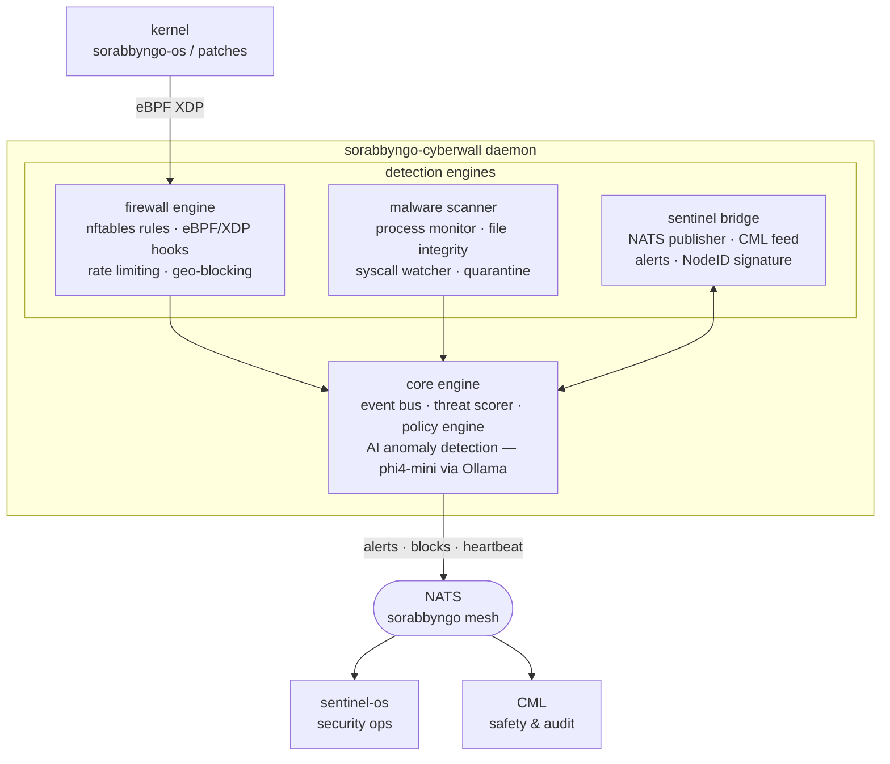

<p align="center">
  
</p>

<p align="center">
  <strong>Sorabbyngo Cyberwall — AI-native firewall and malware defence layer</strong>
</p>

<p align="center">
  Offline-first &nbsp;·&nbsp; Kernel-integrated &nbsp;·&nbsp; NATS-native &nbsp;·&nbsp; Africa-hardened
</p>

---

## What this is

Sorabbyngo Cyberwall is the active defence layer of SORABBYNGO OS. It runs as a daemon on every OS variant — `byngo-os`, `novela-os`, `edge-os`, `server-os` — and provides real-time firewall enforcement, malware detection, process integrity monitoring, and AI-assisted threat analysis. All intelligence stays on-device.

---

## Architecture



---

## Components

| Component | Purpose |
|---|---|
| `cyberwall/core/` | Event bus, threat scoring, policy engine |
| `cyberwall/firewall/` | nftables manager, eBPF/XDP hooks, rate limiter |
| `cyberwall/malware/` | Process monitor, file integrity, syscall watcher, quarantine |
| `cyberwall/sentinel_bridge/` | NATS publisher, CML integration, alert router |
| `cyberwall/ai/` | Ollama-based anomaly analysis (phi4-mini) |
| `cyberwall/policy/` | Policy loader, rule evaluator |
| `nats/` | NATS subject configuration |
| `configs/` | Per-variant configs — novela, edge, server, byngo |
| `scripts/` | Install, start, stop helpers |
| `docs/decisions/` | Architecture decision records (ADRs) |

---

## Quick start

**1. Install dependencies**

```bash
sudo apt-get install -y nftables python3 python3-pip
pip install nats-py watchdog psutil pyyaml cryptography --break-system-packages
```

**2. Configure**

```bash
cp configs/cyberwall.example.yaml configs/cyberwall.yaml
# Edit cyberwall.yaml for your deployment variant
```

**3. Start**

```bash
# Full mode — requires root for nftables + eBPF
sudo python3 cyberwall_daemon.py --config configs/cyberwall.yaml

# Monitor-only mode — no firewall rules applied (dev / unprivileged)
python3 cyberwall_daemon.py --monitor-only --no-root-checks
```

---

## Threat levels

| Level | Score | Automated action |
|---|:---:|---|
| `INFO` | 0–2 | Log only |
| `LOW` | 3–4 | Alert via NATS |
| `MEDIUM` | 5–6 | Alert + rate limit |
| `HIGH` | 7–8 | Block + alert + CML notify |
| `CRITICAL` | 9–10 | Block + quarantine + emergency alert |

---

## NATS subjects

| Subject | Direction | Description |
|---|:---:|---|
| `sorabbyngo.cyberwall.alert` | → pub | Threat alert to sentinel |
| `sorabbyngo.cyberwall.block` | → pub | IP/process block event |
| `sorabbyngo.cyberwall.status` | → pub | Heartbeat and health |
| `sorabbyngo.cyberwall.policy.reload` | ← sub | Hot-reload policy without restart |
| `sorabbyngo.cml.filter.request` | → pub | CML safety check request |

---

## Deployment variants

| Variant OS | Role | Notes |
|---|---|---|
| `byngo-os` | Personal device | Default profile |
| `novela-os` | Health / clinical device | Stricter syscall watch, patient data paths |
| `edge-os` | Edge compute node | Reduced AI load, optimised for low RAM |
| `server-os` | Infrastructure server | Full eBPF/XDP, extended NATS subjects |

---

## Part of SORABBYNGO OS

| Repo | Role |
|---|---|
| [sorabbyngo-os](https://github.com/sorabbyngo-Labs/sorabbyngo-os) | Kernel source — Linux 6.x base |
| [sentinel-os](https://github.com/sorabbyngo-Labs/sentinel-os) | Security operations OS |
| [security](https://github.com/sorabbyngo-Labs/security) | 7-ring defence architecture |
| [dmz](https://github.com/sorabbyngo-Labs/dmz) | One-way wall — PRIME zone isolation |
| [cml](https://github.com/sorabbyngo-Labs/cml) | Cognitive mediation and audit layer |
| [byngonet](https://github.com/sorabbyngo-Labs/byngonet) | AI-native secure mesh protocol |

---

<p align="center">
  <strong>Sorabbyngo Company</strong> &nbsp;·&nbsp; Kisii, Kenya &nbsp;·&nbsp; 2026<br/>
  <em>Rhythm of Digital Life</em>
</p>
