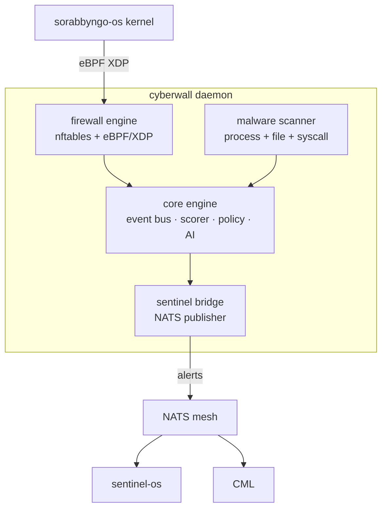

<p align="center">
  
</p>

<p align="center">
  <strong>Sorabbyngo Cyberwall</strong><br/>
  AI-native firewall and malware defence daemon for SORABBYNGO OS
</p>

---

Cyberwall is the active defence layer running on every OS variant. It enforces firewall rules, detects malware, watches syscalls, and routes threat intelligence — all on-device, no cloud dependency.

---

## Architecture



---

## Components

| Path | Role |
|---|---|
| `cyberwall/core/` | Event bus, threat scorer, policy engine |
| `cyberwall/firewall/` | nftables + eBPF/XDP hooks, rate limiter |
| `cyberwall/malware/` | Process monitor, file integrity, syscall watcher, quarantine |
| `cyberwall/sentinel_bridge/` | NATS publisher, CML integration |
| `cyberwall/ai/` | phi4-mini anomaly detection via Ollama |
| `cyberwall/policy/` | Policy loader and rule evaluator |
| `configs/` | Per-variant configs — byngo, novela, edge, server |

---

## Quick start

```bash
# Install
sudo apt-get install -y nftables python3-pip
pip install -r requirements.txt --break-system-packages

# Configure
cp configs/cyberwall.example.yaml configs/cyberwall.yaml

# Run (full — requires root)
sudo python3 cyberwall_daemon.py --config configs/cyberwall.yaml

# Run (dev — no firewall rules)
python3 cyberwall_daemon.py --monitor-only --no-root-checks
```

---

## Threat levels

| Level | Score | Action |
|---|:---:|---|
| INFO | 0-2 | Log |
| LOW | 3-4 | Alert |
| MEDIUM | 5-6 | Alert + rate limit |
| HIGH | 7-8 | Block + alert + CML |
| CRITICAL | 9-10 | Block + quarantine + emergency alert |

---

## NATS subjects

| Subject | Dir | Description |
|---|:---:|---|
| `sorabbyngo.cyberwall.alert` | pub | Threat alert |
| `sorabbyngo.cyberwall.block` | pub | Block event |
| `sorabbyngo.cyberwall.status` | pub | Heartbeat |
| `sorabbyngo.cyberwall.policy.reload` | sub | Hot-reload policy |
| `sorabbyngo.cml.filter.request` | pub | CML safety check |

---

Part of [SORABBYNGO OS](https://github.com/sorabbyngo-Labs/sorabbyngo-os) — Kisii, Kenya · 2026
