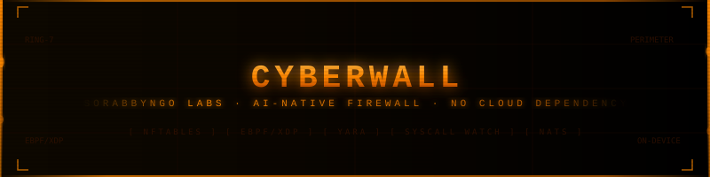
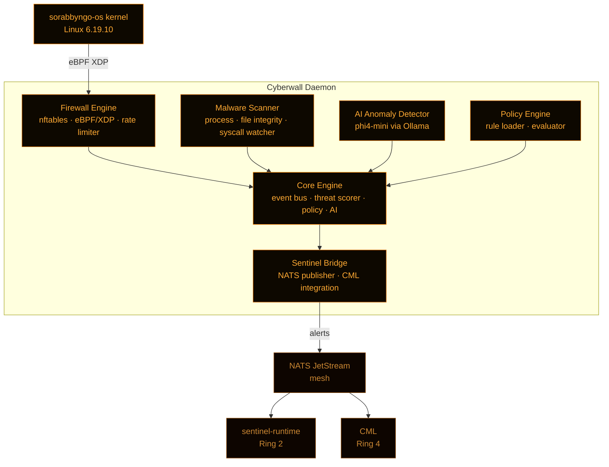

<p align="center">
  
</p>

<p align="center">
  <strong>Sorabbyngo Cyberwall</strong><br/>
  AI-native firewall and malware defence daemon for SORABBYNGO OS
</p>

<p align="center">
  
  
  
  
  
</p>

---

Cyberwall is the active defence layer running on every OS variant. It enforces firewall rules, detects malware, watches syscalls, and routes threat intelligence — all on-device, no cloud dependency.

---

## Architecture



---

## Components

| Path | Role |
|---|---|
| `cyberwall/core/` | Event bus, threat scorer, policy engine |
| `cyberwall/firewall/` | nftables + eBPF/XDP hooks, rate limiter |
| `cyberwall/malware/` | Process monitor, file integrity, syscall watcher, quarantine |
| `cyberwall/ai/` | phi4-mini anomaly detection via Ollama |
| `cyberwall/policy/` | Policy loader and rule evaluator |
| `cyberwall/sentinel_bridge/` | NATS publisher, CML integration |
| `configs/` | Per-variant configs — byngo, novela, edge, server |

---

## Threat levels

| Level | Score | Action |
|---|:---:|---|
| INFO | 0–2 | Log |
| LOW | 3–4 | Alert |
| MEDIUM | 5–6 | Alert + rate limit |
| HIGH | 7–8 | Block + alert + CML notify |
| CRITICAL | 9–10 | Block + quarantine + Byngox escalation |

---

## NATS subjects

| Subject | Direction | Purpose |
|---|---|---|
| `sorabbyngo.cyberwall.alert` | Publish | Threat alert to Sentinel + Byngox |
| `sorabbyngo.cyberwall.block` | Publish | IP block event to Sentinel |
| `sorabbyngo.cml.filter.request` | Publish | Safety filter request to CML |

---

## Quick start

```bash
# Install dependencies
sudo apt-get install -y nftables python3-pip
pip install -r requirements.txt --break-system-packages

# Configure
cp configs/cyberwall.example.yaml configs/cyberwall.yaml

# Run — full daemon (requires root)
sudo python3 cyberwall_daemon.py --config configs/cyberwall.yaml

# Run — dev mode (no firewall rules, no root needed)
python3 cyberwall_daemon.py --monitor-only --no-root-checks
```

---

## Per-variant configs

| Config | OS surface | Notes |
|---|---|---|
| `configs/cyberwall.byngo.yaml` | Byngo OS | Consumer — permissive outbound |
| `configs/cyberwall.novela.yaml` | Novela OS | Medical — strict, FHIR traffic only |
| `configs/cyberwall.edge.yaml` | Edge OS | Minimal — sensor traffic only |
| `configs/cyberwall.server.yaml` | Server OS | High throughput — vLLM + NATS |

---

## Related repositories

| Repo | Ring | Role |
|---|:---:|---|
| `security` | — | 7-ring master architecture |
| `sentinel-runtime` | 2 | Attestation + audit ledger |
| `cml` | 4 | AI safety filter + PII scrubber |
| `byngonet` | 6 | Mesh network trust scoring |
| `sorabbyngo-os` | 1 | Kernel — eBPF/XDP hooks |
| `malware-lab` | — | Detection R&D + YARA rules |

---

<p align="center">
  <strong>Sorabbyngo Company</strong> · Kisii, Kenya · 2026<br/>
  <em>Rhythm of Digital Life</em>
</p>
